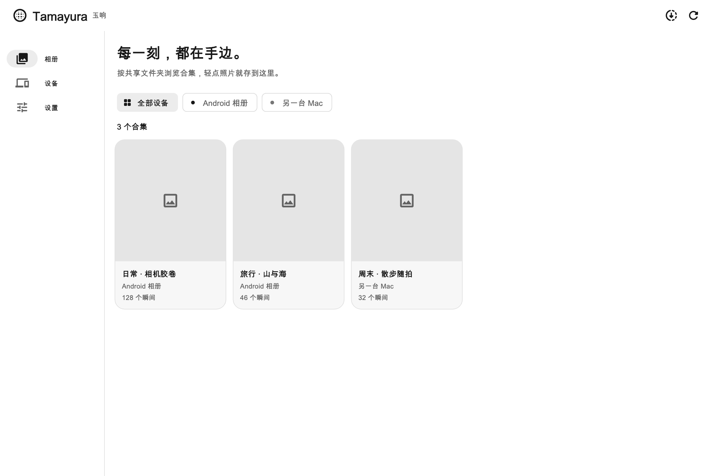
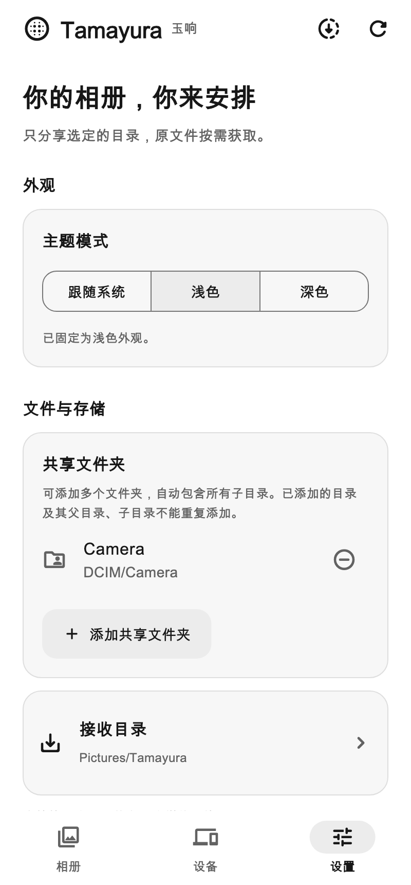
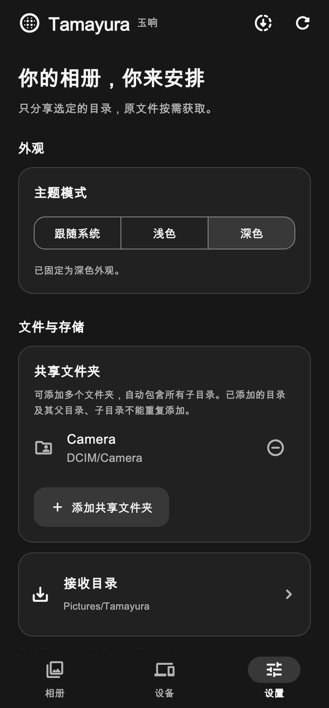

# Tamayura · 玉响

### Your photos, within reach.

**Browse the photos and videos on your own devices.** 
Share folders over your local network, browse previews even when a device is offline, 
and save the originals you want with a tap.

**[Quick start](#quick-start)** &nbsp;·&nbsp; **[Documentation](#documentation)** &nbsp;·&nbsp; **[Changelog](CHANGELOG.md)** &nbsp;·&nbsp; **English** · [简体中文](README.zh-CN.md)

 

Desktop interface preview with sample collections.

## Is Tamayura for you?

Your phone holds the everyday photos. Your computer holds the trips, videos, and older albums. Tamayura brings their previews together so you can find a moment and bring the original to the device in your hands.

- **Choose what to share.** Add one or more folders, including their subfolders, on each device.
- **Browse before downloading.** Previously synced previews stay available when the source device is offline.
- **Keep the originals you want.** Tap a photo or video to download it into your chosen folder.

It is for browsing and transferring media between your own devices on the same local network. It does not automatically copy entire albums or track edits to file contents.

## Quick start

Tamayura is in early development. This README describes the **0.6.1 source**. Its Pre-release is being prepared; use [GitHub Releases](https://github.com/poppinzhang/Tamayura/releases) for published packages and the [0.6.1 release record](docs/releases/0.6.1.md) for verification status. Existing 0.5.0 trial packages have an earlier feature set. Use the **same build** on all devices; 0.6.1 cannot connect to 0.5.0.

**1 · Install and connect.** Choose the package for your platform from [GitHub Releases](https://github.com/poppinzhang/Tamayura/releases) when available, and read the [installation notes](docs/releases/0.6.1.md#安装与数据). To run from source, see the [source build instructions](AGENTS.md#本地开发). Android 0.6.1 uses a new signing certificate: uninstall a 0.5.0 or earlier trial app before installing it; this clears app data and folder permissions. Connect both devices to the same local network and open Tamayura. Allow local network access when prompted; on Windows, allow the app through the firewall on your trusted private network.

**2 · Choose your folders.** In **Settings (设置)**, add the folders you want to share and choose where downloaded files should go. For example, share `DCIM` and receive files in `Pictures/Tamayura`. Subfolders are included automatically. On Android, choose a subfolder rather than the storage root or the `Download` root.

**3 · Find your other device.** Open **Devices (设备)** and wait for automatic discovery. When a new device is found, Tamayura asks whether to sync its album; if you choose not to, you can turn syncing on later from its card. You can also enter the address shown on the other device, or scan its QR code on Android and macOS; these connect and sync right away.

**4 · Open an album.** In **Albums (相册)**, choose a shared collection and tap a photo or video to download its original. The source device must be online for downloads. After adding or removing media, refresh the source device, then refresh the receiving device to update its album immediately.

## Supported platforms

| Platform | Requirements | Package |
| :-- | :-- | :-- |
| Android | Android 16+ · API 36+ | APK |
| macOS | macOS Sequoia 15.0+, including Tahoe 26 and later | Universal app for Apple silicon and Intel |
| Windows | Windows 10 1809+ / Windows 11 · x64 | ZIP; Visual C++ x64 runtime required |

The macOS Pre-release app uses ad-hoc signing and is not notarized; the Windows ZIP is unsigned. Installation details and validation limits are in the [0.6.1 release record](docs/releases/0.6.1.md). iOS and Linux are planned but do not yet have runnable or downloadable builds.

Windows can display a connection QR code, open downloaded files in the default app, and reveal them in Explorer. Camera scanning and the system share sheet are available on Android and macOS.

## How it fits together

Each device chooses its shared folders and remembers the other devices it has connected to. To remove a device together with its offline album, choose **Forget device** from its menu on the Devices page; files you have already downloaded stay on your device. Tamayura first syncs the media list and small previews. Originals stay on their source device until you choose to download them.

Devices discover each other with mDNS / DNS-SD and transfer media directly over gRPC. There is no account or cloud relay to set up.

## What it does

### Your folders, your albums

Each shared folder becomes a collection, including media in its subfolders. Browse across devices, sort a collection by date or name, and choose a compact grid or a detailed view. On mobile, drag the scroll handle to move through a large collection. Downloaded photos use the local image for a clearer preview.

### Previews that stay with you

Synced thumbnails remain available offline. During a sync, photos appear as they arrive; interrupted syncs keep their progress so you can continue later. Automatic sync defaults to a 12-hour interval, which you can change in Settings. If the last sync with a device failed, Tamayura retries as soon as that device appears on the network again. Refresh manually whenever you need an update, and check each device's last successful sync time.

### Originals on demand

Tap to download a photo or video. Files are saved under **device / shared folder / original subfolders**, keeping their names and folder structure. Files larger than **50 MiB** use parallel downloads. You can pause, retry, or cancel a download and remove its temporary data; interrupted transfers can resume from saved progress.

Already saved media can be removed from this device in the app. This leaves the source file and cached preview intact, so you can download it again later.

### Keep sharing in the background

On Android, enable **Settings → Background sharing (后台共享)** to serve files while the phone is locked. Availability depends on the system's battery settings. Downloads can also continue in the background.

On macOS and Windows, closing the window keeps Tamayura in the menu bar or system tray. Background sharing follows its setting, and downloads can continue while the app is running and the computer is awake. Quitting the app or putting the computer to sleep interrupts transfers.

### Light, dark, or your system's choice

A quiet black, white, and gray interface, with a saved theme preference across sessions.

&nbsp;

 
Settings previews with sample folders.

## Documentation

Most detailed documentation is currently in Chinese.

| Guide | What it covers |
| :-- | :-- |
| [Changelog](CHANGELOG.md) | Released and unreleased changes |
| [GitHub Releases](https://github.com/poppinzhang/Tamayura/releases) | Published packages and checksums |
| [0.6.1 release record](docs/releases/0.6.1.md) | Release progress, installation, and known limits |
| [Sync behavior](docs/自动与手动同步.md) | Automatic intervals, manual refresh, and sync status |
| [New and forgotten devices](docs/新设备确认与忘记设备.md) | Confirming newly discovered devices, retrying when a device comes back, and forgetting devices |
| [Downloads and storage](docs/下载存储与清理.md) | Resuming downloads, temporary files, and cleanup |
| [Background sharing](docs/后台共享.md) | Android background availability and battery settings |
| [Development guide](AGENTS.md) | Setup, tests, builds, and implementation references |

## Privacy

Media and previews travel directly between devices on your local network. Each device stores the synced media information and thumbnails locally so you can browse them offline. You choose which folders to share and where to save downloads.

Tamayura currently uses **IPv4 local networks without authentication or transport encryption (TLS)**. Use it only on a trusted network. Guest Wi-Fi and client isolation may prevent devices from connecting.

Before v1.0.0, updates may reset settings, cached albums, and download records. Files in your shared and receiving folders are preserved, but you may need to choose the folders and connect your devices again.

## License

[Apache License 2.0](LICENSE). Third-party components retain their own licenses, available in the app under **Settings → About → Third-party licenses**.
