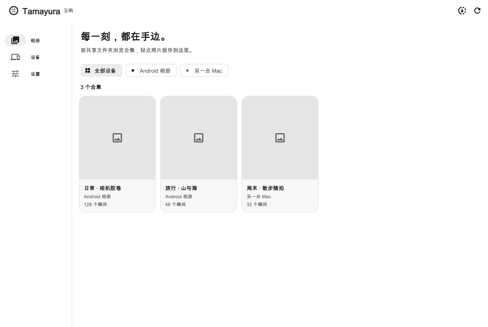
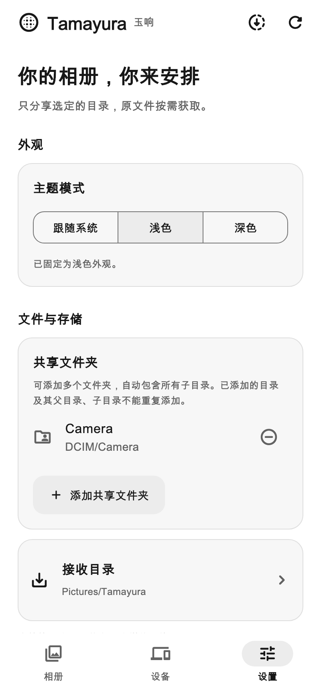
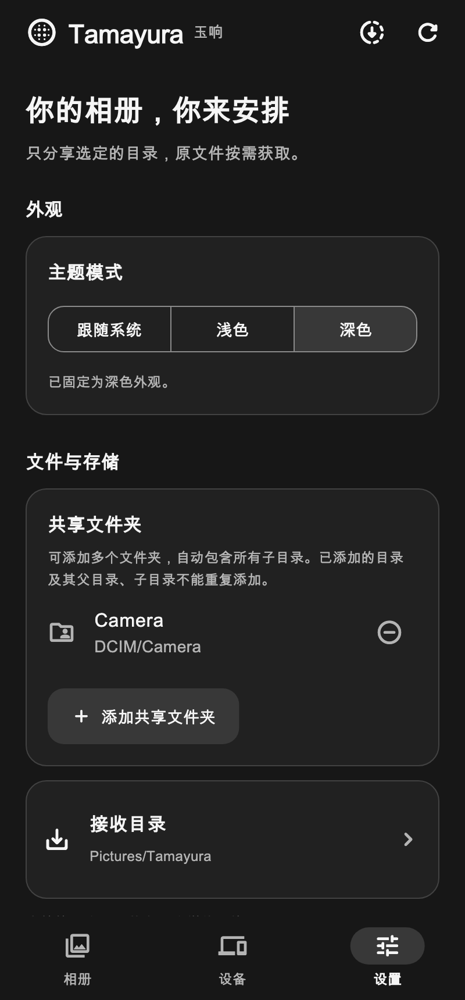

# Tamayura · 玉响

### 把另一台设备里的照片，带到手边。

**在自己的设备之间，浏览和分享照片与视频。** 
在自己的设备之间分享文件夹，离线时也能翻看已同步的预览， 
遇到想留下的瞬间，轻点一下就保存原文件。

**[快速开始](#快速开始)** &nbsp;·&nbsp; **[文档](#文档)** &nbsp;·&nbsp; **[更新记录](CHANGELOG.md)** &nbsp;·&nbsp; [English](README.md) · **简体中文**

 

桌面界面示意，合集为示例数据。

## 玉响适合你吗？

手机里是日常随拍，电脑里是旅行、视频和过去的相册。玉响把它们的预览放到一起，方便你找到某个瞬间，再把原文件带到正在使用的设备上。

- **分享哪些，由你决定。** 每台设备都可以添加多个共享文件夹，自动包含其中的子文件夹。
- **先浏览，再下载。** 同步过的预览会保存在本机，来源设备离线时也能翻看。
- **留下想要的原文件。** 点一下照片或视频，就下载到你选好的接收文件夹。

它适合浏览和传输自己设备上的媒体，不会自动下载整本相册，也不追踪文件内容的修改。

**可选的互联网访问（1.2.0）。** 除局域网外，玉响可以通过内嵌的 Tailscale 节点经互联网访问你自己的其它设备；每台设备分别显示局域网与 Tailscale 在线状态，远程共享需逐台确认。在两端的**设置 → Tailscale 远程连接**中登录，再在两端的**设备**页确认发现的远程设备；相册同步仍需另行确认，仅在局域网中使用玉响无需登录。内嵌节点的账号登录、蜂窝后台使用和真机跨设备验收仍待完成，详见 [实现与验证范围](docs/Tailscale实现.md)。

## 快速开始

**v1.2.1 是最新正式版本**，Android、macOS、Windows 与 Linux 安装包已在 [GitHub Releases](https://github.com/poppinzhang/Tamayura/releases/tag/v1.2.1) 发布。安装说明和验证范围见 [1.2.1 发布记录](docs/releases/1.2.1.md)。v1.0.0 是首个正式版本，此后遵循[兼容与升级策略](docs/兼容与升级.md)。

**1.2.0** 新增可选的 Tailscale 互联网访问：在**设置 → Tailscale 远程连接**中登录并确认每台远程设备后，就能像在局域网中一样通过互联网浏览相册和下载原文件。不登录时一切照旧：玉响仍只使用局域网，不启动任何远程组件，并与 1.0.0–1.1.0 的数据格式保持兼容，升级后设置、相册和下载记录都会保留。Windows 上 1.1.0 引入的 **设置 → 共享文件夹完整核对间隔**（1–8760 整数小时，默认 24）保持不变，仍决定完整核对目录的频率。

**1.2.1** 修复了 Android 上确认 Tailscale 登录后、打开浏览器前应用退出的问题，为较慢隧道上的远端身份查询留出更长时间，并等到节点运行就绪再发现设备或开始远程下载。Android 打开合集后，应用顶栏下直接显示合集名、排序、照片数量和网格；快速滚动块在滚动停止后停留 1.5 秒。Tailscale 设置还会显示本机远程共享是否就绪，以及可见节点中有多少应答玉响。设置、相册和下载记录与 1.2.0 保持兼容。

**1 · 安装并连接网络。** 从 [GitHub Releases](https://github.com/poppinzhang/Tamayura/releases) 选择对应平台的安装包并阅读[安装说明](docs/releases/1.2.1.md#安装与数据)。Android 沿用 0.6.1 起的 release 签名，可覆盖安装同签名版本；debug 或更早不同签名版本需先卸载，这会清除应用数据和目录授权。将两台设备连接到同一局域网，并打开玉响。按提示允许本地网络访问；Windows 请在可信的专用网络中允许应用通过防火墙。离开局域网后的连接方式见第 3 步。

**2 · 选择文件夹。** 在**设置**中添加想分享的文件夹，再选择下载文件的接收目录。例如，分享 `DCIM`，接收到 `Pictures/Tamayura`。子文件夹会自动包含，无需重复添加。Android 请选用子文件夹，不能直接选择存储根目录或 `Download` 根目录。

**3 · 找到另一台设备。** 打开**设备**页面，等待自动发现。发现新设备时，玉响会询问是否同步它的相册；暂不同步的设备可以稍后在它的卡片上开启。也可以输入对方显示的地址，Android 和 macOS 还可以扫描对方的二维码，这两种方式会直接连接并同步。要连接局域网之外的设备，请在两台设备的**设置 → Tailscale 远程连接**中登录 Tailscale；对端会出现在发现的远程设备中，需要在两端分别确认后才会开始远程共享。远程同步和下载会使用当前网络（包括移动数据），可能产生流量费用。

**4 · 打开相册。** 在**相册**中选择共享合集，点一下照片或视频即可下载原文件。下载时来源设备需要在线。新增或删除媒体后，先在来源设备刷新并等待目录扫描完成，再在接收设备刷新以更新相册。

## 检查更新

打开 **设置 → 检查更新**，查询 GitHub 正式 Releases，发现新版本后先由你确认。Android 下载并校验 APK 后进入系统安装流程，需要按提示允许安装此来源的应用并确认更新。Windows 下载并校验完整 ZIP，替换整个应用目录后重新启动；需要完整发行包位于可写的独立本地目录，父目录也须可写，不提供独立安装器，也不自动请求管理员权限。macOS 打开对应版本的 Release 页面，由你自行下载并安装更新。Linux 版同样打开 Release 页面，由你下载对应架构的 tar.gz 并自行替换应用目录。

已安装 0.8.0 或更新版本的用户可通过「检查更新」找到 1.2.1；更早版本需手动安装。检查和下载更新需要互联网连接。升级会中断共享和传输，重新打开应用后可重试中断的媒体下载。Windows 首次运行升级后的程序前，请先从托盘菜单退出旧的 v1.0.0 程序。限制与真机验证范围见 [1.2.1 发布记录](docs/releases/1.2.1.md)。

## 支持的平台

| 平台 | 系统要求 | 安装形式 |
| :-- | :-- | :-- |
| Android | Android 16+ · API 36+ | APK |
| macOS | macOS Sequoia 15.0+，支持 Tahoe 26 及后续版本 | Apple 芯片与 Intel 通用 App |
| Windows | Windows 10 1809+ / Windows 11 · x64 | ZIP；需要 Visual C++ x64 运行库 |
| Linux（自 1.0.0 起） | Ubuntu 24.04 LTS 或更新的桌面发行版，glibc 2.39+、GTK 3.24 · x64 / arm64 | tar.gz 应用目录 |

macOS 使用 ad-hoc 签名，尚未公证；Windows 与 Linux 包未签名。GitHub 正式 Release 不代表平台公证或应用商店发行。安装细节和验证范围见 [1.2.1 发布记录](docs/releases/1.2.1.md)。Linux 自 1.0.0 起加入，更早版本不含 Linux 安装包。iOS 属于后续目标，尚未提供可运行或下载的版本。

Windows 可以展示连接二维码、用默认应用打开已下载文件，以及在资源管理器中定位文件。相机扫码和系统分享面板可在 Android、macOS 上使用。

Linux 版同样可以展示连接二维码、用默认应用打开已下载文件，以及在文件管理器中显示文件。完整解压目录后运行 `tamayura`；在该目录运行 `install-desktop-entry.sh` 可将玉响加入应用菜单，移动目录后需重新运行。自动发现需要多数桌面发行版自带的 Avahi 守护进程，中文和日文显示需要安装 Noto Sans CJK 等中日文字体。详情见 [Linux 实现](docs/Linux原型.md)。

## 它如何工作

每台设备自行选择共享文件夹，并记住连接过的其它设备。需要移除某台设备及其离线相册时，在设备页面的设备菜单中选择**忘记设备**；已经下载到本机的文件会保留。玉响先同步媒体列表和小尺寸预览，原文件保留在来源设备上，直到你选择下载。

设备通过 mDNS / DNS-SD 自动发现彼此，通过 gRPC 直接传输媒体；局域网使用无需注册账号或配置云端中转。也可以选择登录自己的 Tailscale 账号，让已确认的设备经玉响内嵌的 Tailscale 节点通过互联网互相访问，不会安装系统 VPN。

## 主要功能

### 你的文件夹，就是你的相册

每个共享文件夹对应一个合集，其中也包含子文件夹里的媒体。可以按设备浏览，按日期或名称排序，选择紧凑网格或详细视图。移动端支持拖动滚动块，快速定位大合集中的照片；已下载的照片优先使用本地图片显示更清晰的预览。

### 离线也能翻看的预览

同步过的缩略图会保留在本机。同步时照片逐步出现，中断后保留进度，稍后可以继续。自动同步默认间隔为 **10 分钟**，设置中可填写 **1–525600 的整数分钟**（最长一年）；与某台设备的上一次同步失败时，它重新出现在局域网中会立即重试。需要立即更新时随时手动刷新，也可以查看每台设备最后成功同步的时间。

升级到 0.7.0 时，旧的小时设置不沿用；尚未保存分钟设置时使用默认 10 分钟。移动端快速滚动支持连续拖动并在松手后自动隐藏。Windows 优先使用可用的 RAW 内嵌预览，并在内存中保留最近生成的缩略图，减少重复解码；格式支持仍取决于系统已安装的解码器。

### 想要原文件，点一下

点击照片或视频即可下载。文件按**设备 / 共享文件夹 / 原有子文件夹**保存，保留文件名和目录结构。超过 **50 MiB** 的文件会并发下载。下载支持暂停、重试，以及取消并删除临时数据；中断后可以从已保存的进度继续。

已经保存的媒体也可以在应用内删除本地文件。来源设备的原文件和缓存预览会保留，以后仍可再次下载。

### 后台继续分享

Android 在**设置 → 后台共享**中开启后，可以在锁屏时继续提供文件，实际可用性受系统电池设置影响。下载也可以在后台继续。

macOS 和 Windows 关闭窗口后，玉响会留在菜单栏或系统托盘。后台共享遵循设置开关，应用运行且电脑清醒时下载可继续；退出应用或让电脑进入睡眠会中断传输。Linux 版在桌面提供系统托盘时（例如 KDE Plasma 或 Ubuntu 的 AppIndicator）关闭窗口后留在托盘，否则关闭窗口即退出；按 Ctrl+Q 退出。

### 简体中文、日本語与 English

**0.9.0** 支持简体中文、日语和英语界面：默认跟随系统首选语言中第一个受支持的语言，没有受支持语言时显示英文。也可以随时在**设置 → 外观 → 语言**中切换，选择会保留。通知文案、菜单栏或系统托盘菜单以及目录选择器标题同样跟随所选语言。

已保存的错误提示保留原语言；Android 已在进行的下载，其后续错误提示仍可能沿用切换前的语言。部分系统弹窗与按钮跟随操作系统语言。完整范围与限制见[多语言](docs/多语言.md)。

### 浅色、深色，或跟随系统

简洁的黑白灰界面，主题选择会在下次打开时保留。

&nbsp;

 
设置界面示意，文件夹为示例数据。

## 文档

详细文档目前主要使用中文。

| 文档 | 内容 |
| :-- | :-- |
| [更新记录](CHANGELOG.md) | 已发布与未发布的变更 |
| [GitHub Releases](https://github.com/poppinzhang/Tamayura/releases) | 已发布安装包与校验和 |
| [1.2.1 发布记录](docs/releases/1.2.1.md) | 正式发布状态、安装影响和验证范围 |
| [Tailscale 实现](docs/Tailscale实现.md) | 远程连接的设计、安全边界与验证范围 |
| [自动与手动同步](docs/自动与手动同步.md) | 自动间隔、手动刷新与同步状态 |
| [新设备确认与忘记设备](docs/新设备确认与忘记设备.md) | 新发现设备的确认、设备重新上线时的重试以及忘记设备 |
| [下载存储与清理](docs/下载存储与清理.md) | 下载续传、临时文件与清理 |
| [多语言](docs/多语言.md) | 语言选择、翻译范围与限制 |
| [后台共享](docs/后台共享.md) | Android 后台可用性与电池设置 |
| [Linux 实现](docs/Linux原型.md) | Linux 版：系统要求、安装、托盘与限制 |
| [开发指南](AGENTS.md) | 环境准备、测试、构建与实现文档索引 |

## 隐私

媒体与预览在自己的设备之间传输。每台设备在本地保存已同步的媒体信息和缩略图，方便离线浏览。共享哪些文件夹、把下载保存到哪里，都由你选择。

LAN 传输目前**不提供应用层身份验证或传输加密（TLS）**，请将访问范围限制为可信设备，不要直接把服务端口暴露到公网。可选的 Tailscale 路径（1.2.0 起）提供隧道加密及已批准节点的访问控制，但不会保护独立的 LAN 监听入口。本地 mDNS 自动发现仍依赖组播；访客 Wi-Fi 或设备隔离可能阻止发现或连接。

同一主版本内的正式更新须保留设置、缓存相册与下载记录。遇到不受支持的数据库版本时保留原数据并报告错误。更早的 0.x 数据库结构不在迁移基线内，调整安装前请先备份应用数据；升级不删除共享原文件和接收目录中已保存的文件。

## 开源许可

[Apache License 2.0](LICENSE)。第三方组件保留各自的许可，可在应用的**设置 → 关于 → 第三方开源许可**中查看。
