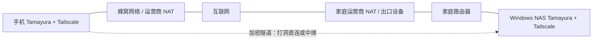

# 互联网访问规划

状态：2026-11-15 已开始实现，随 1.2.0 发布。用户已验证台式机与手机使用独立 Tailscale 客户端可在互联网直连；这属于线路验证，不能替代内嵌 tsnet 的验收。当前实现和检查结果见 [Tailscale 实现](Tailscale实现.md)，本文保留网络背景与原方案比较。1.1.0 及更早安装包仍是接入前能力。

## 目标场景与可行性

移动设备通过运营商蜂窝网络，访问家庭 NAS 上的 Tamayura。本场景的 NAS 是一台 Windows 机器，用户已确认现有 Tamayura Windows 版运行正常，无需为此新增 NAS 专用服务端。家庭一侧依次经过家庭路由器、运营商出口设备和运营商 NAT（CGNAT）；如果出口设备也做 NAT，可能有更多层地址转换。

Tailscale 可以承载这种连接。双方主动建立组网连接并尝试 UDP 打洞；无法直连时使用中继，默认可回退到 DERP。两端都不必拥有可供入站访问的公网 IPv4，通常无需在家庭路由器上手动映射端口。能否直连取决于两端 NAT、UDP 和防火墙行为，不能只根据 NAT 层数判断；仅在家庭路由器映射端口也无法控制运营商的上游 NAT。前提是双方能够访问所需的协调与中继服务，受限网络仍需实测。[Tailscale 连接类型](https://tailscale.com/docs/reference/connection-types)、[防火墙与端口](https://tailscale.com/docs/reference/faq/firewall-ports)

这里的“直连”仍经过上述物理网络，只是不经过传输中继。中继路径仍在 Tailscale 节点之间端到端加密；中继无法因此读取媒体明文，但会占用中继带宽并增加延迟。媒体下载吞吐还受家庭上行、手机链路和设备处理能力限制，不能预先承诺接近局域网速度。[Tailscale 数据路径](https://tailscale.com/docs/concepts/traffic-routing-through-tailscale)

## 已选择的接入方向

第一阶段在 Tamayura 的设置页提供可选的 Tailscale 登录，连接官方管控服务；设备页发现允许访问的 Tamayura 对端，分别标注局域网 / Tailscale 在线，并共用相册和下载流程。未登录、认证失败、管控不可达或退出登录不影响原有局域网能力。自建 Headscale 配置留待以后有需求时再开放。

发现与连接顺序已确定：先通过 LAN 检查已记住设备，本机互联网可用时再检查 Tailscale 是否已注册、是否就绪，就绪后查询远端候选并核验 Tamayura 服务。Tailscale 同时可以发现未记住的新设备，不能因为 LAN 已找到设备就跳过；LAN 首轮检查有界，不等待持续发现结束。同一设备的新操作优先 LAN，路径状态分别保留，细节以需求文档为准。

按前述讨论采用 `tsnet` 内嵌方向，目标是无需另装系统 Tailscale 客户端。它运行应用内的用户态网络栈，普通 Dart 系统 Socket 不会自动进入该网络，需要对客户端拨号与服务端监听进行桥接；gRPC / HTTP/2 与媒体业务可以保留。当前采用本机 TLS 认证与 CONNECT 握手后的 TCP 双向转发。具体方案和兼容边界见 [Tailscale 接入需求](Tailscale接入需求.md) 与 [兼容与升级](兼容与升级.md)。[tsnet 官方说明](https://tailscale.com/docs/features/tsnet)

本机透明转发由 Go 组件监听回环入口，承接 Dart gRPC 客户端连接，再经 tsnet 连接对端；对端 Go 组件也需监听虚拟服务端口并接入同机 Dart gRPC 服务，进行双向原始字节转发。多目标需要独立的映射管理；桌面辅助进程与移动端原生库是待验证的不同运行形态，不把“Go 子服务”限定为所有平台都必须启动独立进程。

Tailscale 默认为节点分配 `100.64.0.0/10` 范围内的 IPv4 地址，Wi-Fi 与蜂窝网络切换不会因此改变同一节点的 Tailscale 地址。内嵌节点拥有自己的网络身份，不应等同于同机系统 Tailscale 客户端的节点；退出后重新注册也不能假设地址始终相同。该地址属于虚拟网络，不是公网入口。[Tailscale 地址](https://tailscale.com/docs/concepts/tailscale-ip-addresses)

前期仍可让手机与 Windows 分别安装官方客户端、加入同一 tailnet，先验证家庭宽带与蜂窝网络能否通信。这是独立于 Tamayura 开发的线路验证，不是本次产品交付方式，也不能代替 tsnet 与 Flutter 的平台验证。采用系统客户端时需另查运营商或其他 VPN 使用相同地址段导致的路由冲突。[CGNAT 地址冲突](https://tailscale.com/docs/reference/troubleshooting/network-configuration/cgnat-conflicts)

本次只需要应用自己的媒体连接，不要求把手机全部互联网流量送回家，也不配置 exit node、subnet router 或公网 Funnel。Windows 端继续运行现有 Tamayura 应用。

## 当前实现与剩余验收

| 范围 | 1.2.0 实现 | 仍需验证 |
| --- | --- | --- |
| 登录 | Flutter-Tailscale 内嵌 tsnet、独立节点状态、浏览器登录和退出 | 真实账号登录、审批、到期与平台恢复 |
| 发现与信任 | 可见节点的身份专用端口探测；确认后绑定网络 / 节点 / Tamayura ID；媒体端口默认拒绝 | 真实 tailnet 策略与双端配对 |
| 连接 | 保留 LAN 地址；已确认绑定通过 SDK 的 gRPC 连接器；短暂初次连接失败可切路 | 直连 / DERP、长传输和恢复性能 |
| Android | 已确认远端任务增加蜂窝调度；前台与 UIDT 引擎共用原生节点所有者 | API 36 真机、后台锁屏、引擎销毁与 Wi-Fi / 蜂窝切换 |
| 平台与分发 | Android 进程内库；桌面应用内打包 Go 辅助进程 | 各平台真实运行和完整安装包验收 |
| 兼容 | 沿用 schema 7 / schema 3 / gRPC v4；新增版本化绑定配置 | 真机覆盖升级和持久状态恢复 |

手动 IP、二维码和 mDNS 继续用于 LAN；不把 Tailscale 虚拟地址交给系统 Socket，也不向公网暴露媒体端口。具体实现参数以 [实现文档](Tailscale实现.md) 为准。

Tailscale 的 MagicDNS 是设备名称解析，不能替代 Tamayura 的服务发现。第一阶段远端发现走本地 peer 列表与应用探测，不依赖跨隧道传播 mDNS；它有可用 API 基础，具体版本、平台和策略可见范围仍须验证。[Tailscale mDNS 跟踪项](https://github.com/tailscale/tailscale/issues/1013)、[本地节点状态 API](https://pkg.go.dev/tailscale.com/client/local#Client.Status)

本场景沿用 [Windows 实现](Windows原型.md) 和 [桌面托盘与窗口生命周期](桌面托盘与窗口生命周期.md) 的运行边界，不增加开机自启、后台系统服务或远程唤醒。如果以后扩展到其他 NAS 系统，需要另行核对运行环境；现有 Linux 桌面包不等同于通用 NAS 套件或无界面服务。

Android 采用官方系统客户端做线路验证时，每个用户或工作资料通常只能运行一个 VPN 服务，与其他系统 VPN / TUN 应用不能假设同时启用；也需确认 Tamayura 没有被按应用路由排除。计划内嵌的 tsnet 用户态节点本身不要求创建系统 VPN，但仍受系统网络、其他代理路由、后台执行及平台兼容性影响；这两种部署方式不能混为一谈。[Android VPN 服务与按应用路由](https://developer.android.com/develop/connectivity/vpn)、[tsnet 用户态网络](https://pkg.go.dev/tailscale.com/tsnet)

## 访问边界

第一阶段将 Tailscale 路径限制给已授权的个人设备，用 grants / ACL 约束来源、目标及 TCP 端口。建议内嵌节点使用固定虚拟端口 `50728`，与当前 LAN 默认 `50728`、占用后动态回退的端口分开管理；发现与监听方案须一并验证。主机防火墙与回环入口约束仍需按实际部署核验，不能因虚拟路径受保护而开放其它入口。[Tailscale grants](https://tailscale.com/docs/features/access-control/grants)

当前 gRPC 不做应用层加密或认证。Tailscale 保护的是经过其隧道的流量，不会自动保护通过其他网卡访问同一监听端口的连接。直接映射服务到公网、开放给任意互联网客户端，需要另行设计应用层认证、加密和授权；本次未实现这种部署方式。

## 类似技术

| 方案 | 对目标场景的适用性 | 评估重点 |
| --- | --- | --- |
| Tailscale | 已选择第一阶段接入官方管控，内嵌方案待实现，NAT 打洞失败可中继 | 实际运营商下管控可达性、直连与中继吞吐、tsnet 平台桥接和生命周期 |
| ZeroTier | 同样提供虚拟组网、NAT 穿透和中继，可作为备选 | 实际链路、客户端支持、路由与防火墙；TCP 回退可能较慢，不能保证自动获得高速直连 |
| NetBird | 同样以组网方式连接 NAT 后的设备，无法直连时可使用中继 | 托管或自建的运维要求、移动端与 NAS 适配，以及所在地中继性能 |

替代技术可行的依据：[ZeroTier 路由与中继说明](https://docs.zerotier.com/routertips/)、[NetBird NAT 与连接机制](https://docs.netbird.io/about-netbird/understanding-nat-and-connectivity)。目前没有对三者做同环境性能对比，选用其他方案也不会自动解除 Tamayura 的蜂窝下载和 NAS 运行限制。

## 中国大陆网络的证据边界

完成 Google 等账号认证不等于后续所有网络路径持续可用。官方管控连接、STUN / NAT 穿透、端点直连及 DERP 中继需要分别验证。公开记录中既有成功，也有随时间、运营商组合变化的失败：

- 2026-08-07～08，中国移动家宽用户明确报告没有额外代理 / VPN，官方管控握手先失败，约 12 小时后在未改配置的情况下恢复，默认配置五次均成功。这是特定线路的控制连接记录，不是全国可用性保证，也不是设备传输性能验收。[官方仓库 #20777](https://github.com/tailscale/tailscale/issues/20777)
- 2025-12-30 的手机访问 NAS 讨论中，用户已确认打洞直连，但电信 5G 到移动家宽传输差，换用移动网络后可传输。同帖也有跨运营商成功报告；不能据此将丢包原因或性能推广到所有用户。[第一手讨论](https://v2ex.com/t/1182201)

没有在本项目的目标线路执行实测。应在认证完成并关闭辅助登录代理后，检查重启与重连、蜂窝切换、直连 / 中继和晚高峰持续传输，再确定产品支持范围。

## 后续验证顺序

以下是待执行计划，本次没有安装客户端、修改路由或进行实机传输。

1. 沿用已可运行的 Windows NAS，可先通过两端官方客户端验证实际线路；手机关闭 Wi-Fi、使用蜂窝网络，访问一项已授权测试服务。支持 CLI 的一端可使用 `tailscale status`、`tailscale ping <对端隧道地址>`、`tailscale netcheck` 观察路径。这一步不算完成 Tamayura 接入。
2. 原型验证 tsnet 在 Android 与 Windows 上的运行、登录、状态持久化、peer 枚举和双向连接，再验证 macOS / Linux。确定桥接、虚拟服务端口和发现机制，不能把有库可调用等同于全平台已支持。
3. 按 [Tailscale 接入需求](Tailscale接入需求.md) 实现可选登录、发现、双路径状态及连接适配，再覆盖相册分页、缩略图、小文件、大于 50 MiB 的四路下载，以及直连和中继。
4. 验证未登录、登录失败、退出及账号切换下 LAN 能力独立可用；验证双路径去重、断线选路、手机锁屏、Windows 托盘 / 睡眠、蜂窝切换和断点恢复，记录实际耗时、吞吐与蜂窝用量。
5. 验证未授权设备无法访问服务、策略撤销与退出后连接受限、不同监听入口没有意外暴露；完成数据迁移与同主版本兼容测试，再更新真实支持范围。

记录仅保留通用网络条件和脱敏结果，不提交实际内网地址、设备名称、账号、密钥或连接凭据。真实验收完成后再更新支持范围与发行说明。
